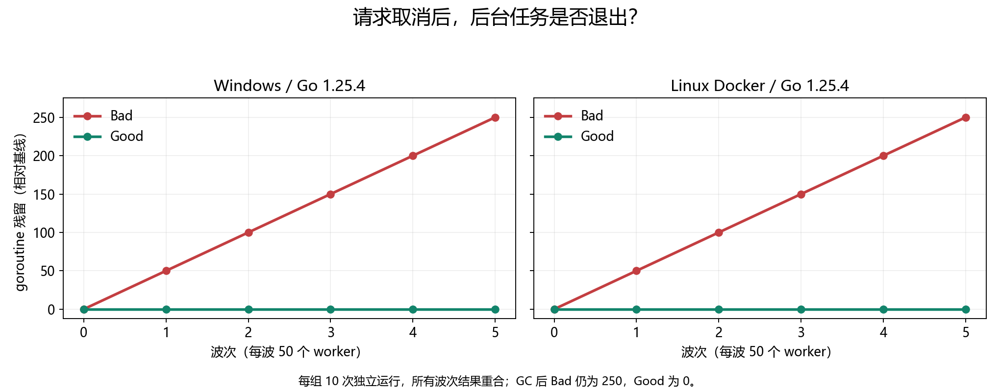

# 001 · 请求已经取消，goroutine 为什么还留在进程里？

取消调用方是否会自动打断 worker 的 channel send？

## 实验方法

屏障确认进入发送路径后取消；Bad/Good 各独立跑 10 次，每次 5 波，每波 50 worker，采 goroutine 栈与计数。

## 环境

Python 3.12；PowerShell 7。

Go 1.25.4 或兼容版本；脚本会记录实际版本。

如选择容器入口，另需 Docker Linux Engine 与 Compose。

## 运行

在仓库根打开 PowerShell，按顺序执行：

~~~powershell
cd labs/001-go-goroutine-leak
./scripts/reproduce.ps1
./scripts/cleanup.ps1
~~~

默认原生执行；也可执行 ./scripts/reproduce.ps1 -Backend docker。

目录内另提供 scripts/reproduce.sh；以脚本所需的系统和工具为准。

每次运行生成新的 results 子目录，包含 stdout、stderr、环境信息和校验清单；这些本机输出默认由 Git 忽略。预期的错误退出由实验验证器判定，不能只凭子进程退出码判断修复是否成立。

## 示例结果

worker 向无人接收的无缓冲 channel 发送结果会残留；修复是在阻塞发送处监听 ctx.Done，并等待 worker 结束。

图与 CSV 来自一次固定环境中的历史运行，供理解对照关系；新运行的精确时间、PID、内存和调度数据可能不同。此目录的复现入口会执行新的实验，不依赖历史原始日志。

## 代码入口

- [实现与领域验证](src)
- [实验入口](scripts/reproduce.ps1)
- [容器配置](docker-compose.yml)

清理脚本只作用于本实验的进程、容器、集群或工作目录；请先阅读脚本。实验中的固定口令用于本地演示环境。
