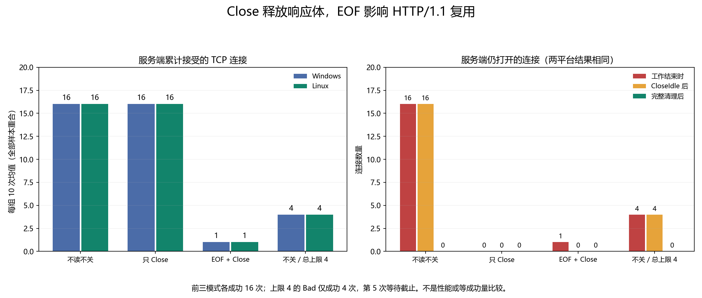

# 005 · HTTP 请求都成功了，连接池为什么越来越忙？

响应体的消费和关闭怎样影响 HTTP/1.1 连接复用？

## 实验方法

本地 httptest 固定响应，不读不关、只关、读完关闭三组；httptrace 和服务端连接计数；补充 MaxConnsPerHost=4 的第5次等待截止。

## 环境

Python 3.12；PowerShell 7。

Go 1.25.4 或兼容版本；脚本会记录实际版本。

Docker Engine 的 Linux 容器模式及 Docker Compose。

## 运行

在仓库根打开 PowerShell，按顺序执行：

~~~powershell
cd labs/005-http-client-reuse
./scripts/reproduce.ps1
./scripts/cleanup.ps1
~~~

目录内另提供 scripts/reproduce.sh；以脚本所需的系统和工具为准。

每次运行生成新的 results 子目录，包含 stdout、stderr、环境信息和校验清单；这些本机输出默认由 Git 忽略。预期的错误退出由实验验证器判定，不能只凭子进程退出码判断修复是否成立。

## 示例结果

用本地httptest服务、固定256KiB响应，对比不读不关、只关、读到EOF并关闭，并补充MaxConnsPerHost=4时的等待故障。Windows/Linux共80独立进程，每组10/10符合验收。

图与 CSV 来自一次固定环境中的历史运行，供理解对照关系；新运行的精确时间、PID、内存和调度数据可能不同。此目录的复现入口会执行新的实验，不依赖历史原始日志。

## 代码入口

- [实现与领域验证](src)
- [实验入口](scripts/reproduce.ps1)
- [容器配置](docker-compose.yml)

清理脚本只作用于本实验的进程、容器、集群或工作目录；请先阅读脚本。实验中的固定口令用于本地演示环境。
