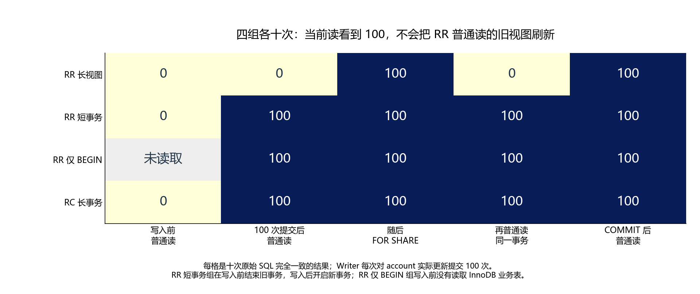

# 013 · 数据已经更新，长事务为什么还读到旧值？

RR ReadView 和长事务对历史版本保留有什么关系？

## 实验方法

三持续会话响应屏障；RR/RC普通与当前读四组×10；真实提交与history采样，公开purge控制及失败协议保留。

## 环境

Python 3.12；PowerShell 7。

Docker Engine 的 Linux 容器模式及 Docker Compose。

## 运行

在仓库根打开 PowerShell，按顺序执行：

~~~powershell
cd labs/013-mysql-mvcc-long-transaction
./scripts/start.ps1
./scripts/reproduce.ps1
./scripts/cleanup.ps1
~~~

目录内另提供 scripts/reproduce.sh；以脚本所需的系统和工具为准。

每次运行生成新的 results 子目录，包含 stdout、stderr、环境信息和校验清单；这些本机输出默认由 Git 忽略。预期的错误退出由实验验证器判定，不能只凭子进程退出码判断修复是否成立。

## 示例结果

MySQL8.4.11/Linux Docker，四场景各十组、120条持续客户端会话，全部符合验收。长RR稳定0/100/0，其他三组100/100/100；提交后均100。每组100次正式业务提交，原始SQL与history采样完整保留。

图与 CSV 来自一次固定环境中的历史运行，供理解对照关系；新运行的精确时间、PID、内存和调度数据可能不同。此目录的复现入口会执行新的实验，不依赖历史原始日志。

## 代码入口

- [实现与领域验证](src)
- [实验入口](scripts/reproduce.ps1)
- [SQL](sql)
- [容器配置](docker-compose.yml)

清理脚本只作用于本实验的进程、容器、集群或工作目录；请先阅读脚本。实验中的固定口令用于本地演示环境。
