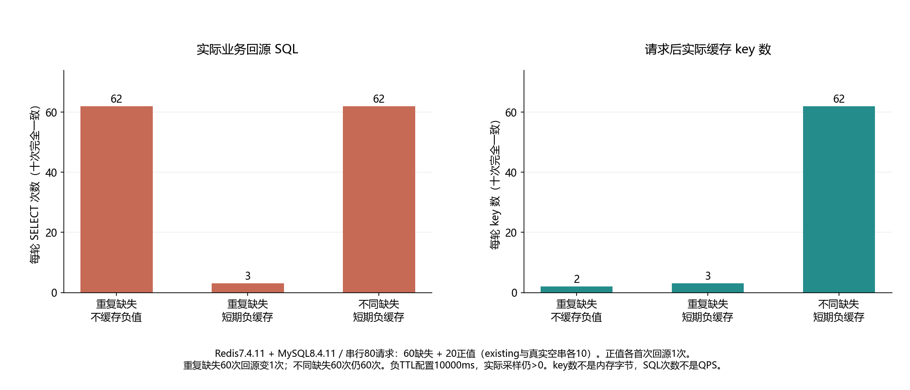

# 016 · 不存在的key反复回源，负缓存加上以后为什么又挡住了新数据？

负缓存怎样减少重复缺失回源，为什么不同新key仍回源且新建数据被旧负值挡住？

## 实验方法

实际Redis/MySQL五场景各十次：80串行lookup的重复/不同缺失对照、真实空串、创建后TTL/DEL；原始RESP/SQL及PTTL+TIME采样。

## 环境

Python 3.12；PowerShell 7。

Docker Engine 的 Linux 容器模式及 Docker Compose。

## 运行

在仓库根打开 PowerShell，按顺序执行：

~~~powershell
cd labs/016-redis-cache-penetration
./scripts/start.ps1
./scripts/reproduce.ps1
./scripts/cleanup.ps1
~~~

目录内另提供 scripts/reproduce.sh；以脚本所需的系统和工具为准。

每次运行生成新的 results 子目录，包含 stdout、stderr、环境信息和校验清单；这些本机输出默认由 Git 忽略。预期的错误退出由实验验证器判定，不能只凭子进程退出码判断修复是否成立。

## 示例结果

Redis7.4.11/MySQL8.4.11，五场景各十次50组、2630串行lookup/1310实际业务SELECT、100持续CLI/50RESP会话。80请求的重复缺失SQL62→3，不同缺失仍62；创建后TTL十轮各10旧None，DEL十轮各10created。未声称生产吞吐或数据库实际压垮。

图与 CSV 来自一次固定环境中的历史运行，供理解对照关系；新运行的精确时间、PID、内存和调度数据可能不同。此目录的复现入口会执行新的实验，不依赖历史原始日志。

## 代码入口

- [实现与领域验证](src)
- [实验入口](scripts/reproduce.ps1)
- [SQL](sql)
- [容器配置](docker-compose.yml)

清理脚本只作用于本实验的进程、容器、集群或工作目录；请先阅读脚本。实验中的固定口令用于本地演示环境。
