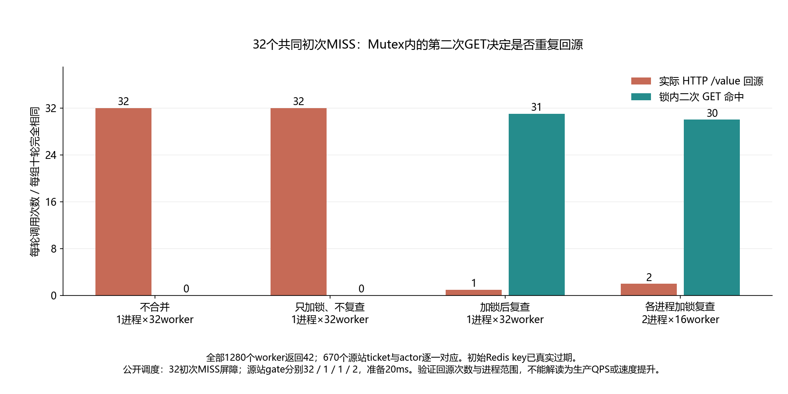

# 017 · 已经加了互斥锁，为什么热点 key 仍回源 32 次？

只加锁为什么仍重复回源，锁内二次GET的作用及进程边界是什么？

## 实验方法

真实过期、32初次MISS屏障；无合并/只锁/锁内复查/双进程四组各十轮；原始RESP与HTTP ticket交叉核对。

## 环境

Python 3.12；PowerShell 7。

Go 1.25.4 或兼容版本；脚本会记录实际版本。

Docker Engine 的 Linux 容器模式及 Docker Compose。

## 运行

在仓库根打开 PowerShell，按顺序执行：

~~~powershell
cd labs/017-redis-cache-breakdown
./scripts/start.ps1
./scripts/reproduce.ps1
./scripts/cleanup.ps1
~~~

目录内另提供 scripts/reproduce.sh；以脚本所需的系统和工具为准。

每次运行生成新的 results 子目录，包含 stdout、stderr、环境信息和校验清单；这些本机输出默认由 Git 忽略。预期的错误退出由实验验证器判定，不能只凭子进程退出码判断修复是否成立。

## 示例结果

真实 Redis7.4.11、Go1.25.4 Windows原生actor和Linux HTTP源站，四组各十轮。全部1280个worker返回42；无合并/仅加锁/锁内复查/双进程复查，每轮实际HTTP回源32/32/1/2。源站是受控固定值服务，计数指HTTP `/value`，不指数据库查询。

图与 CSV 来自一次固定环境中的历史运行，供理解对照关系；新运行的精确时间、PID、内存和调度数据可能不同。此目录的复现入口会执行新的实验，不依赖历史原始日志。

## 代码入口

- [实现与领域验证](src)
- [实验入口](scripts/reproduce.ps1)
- [容器配置](docker-compose.yml)

清理脚本只作用于本实验的进程、容器、集群或工作目录；请先阅读脚本。实验中的固定口令用于本地演示环境。
