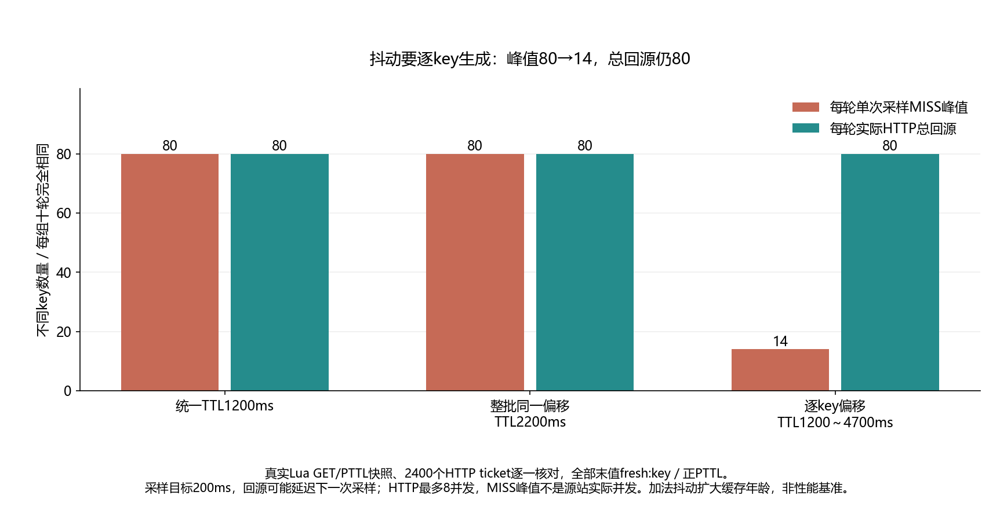

# 018 · 给整批 key 加了随机 TTL，为什么还是一起过期？

整批偏移与逐key偏移如何影响MISS触发、实际HTTP时间分布和总回源？

## 实验方法

80真实key共同Redis TIME基点/PXAT；统一TTL、整批偏移、逐key偏移各十次；实际Lua GET/PTTL与HTTP ticket/500ms桶交叉核对。

## 环境

Python 3.12；PowerShell 7。

Docker Engine 的 Linux 容器模式及 Docker Compose。

## 运行

在仓库根打开 PowerShell，按顺序执行：

~~~powershell
cd labs/018-redis-cache-avalanche
./scripts/start.ps1
./scripts/reproduce.ps1
./scripts/cleanup.ps1
~~~

目录内另提供 scripts/reproduce.sh；以脚本所需的系统和工具为准。

每次运行生成新的 results 子目录，包含 stdout、stderr、环境信息和校验清单；这些本机输出默认由 Git 忽略。预期的错误退出由实验验证器判定，不能只凭子进程退出码判断修复是否成立。

## 示例结果

真实Redis7.4.11/Go1.25.4 Linux HTTP源站/Python3.12.7客户端，三个场景各十轮。统一1200ms、整批抖动2200ms、逐key1200..4700ms，每轮采样MISS峰值80/80/14；总HTTP回源全部80。按源站monotonic、相对每轮首个/value启动分500ms桶，峰值80/80/20～22，实际处理重叠三组均8。

图与 CSV 来自一次固定环境中的历史运行，供理解对照关系；新运行的精确时间、PID、内存和调度数据可能不同。此目录的复现入口会执行新的实验，不依赖历史原始日志。

## 代码入口

- [实现与领域验证](src)
- [实验入口](scripts/reproduce.ps1)
- [容器配置](docker-compose.yml)

清理脚本只作用于本实验的进程、容器、集群或工作目录；请先阅读脚本。实验中的固定口令用于本地演示环境。
