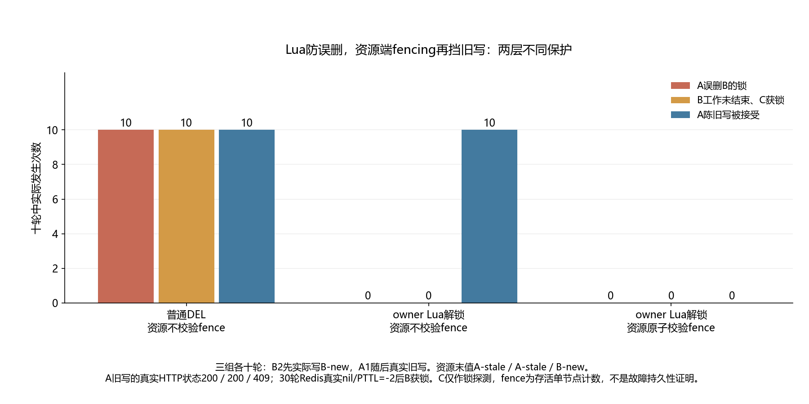

# 019 · Redis 锁用了 owner Lua，为什么旧任务还是覆盖了新值？

过期旧流程误删新owner锁与覆盖新值，owner解锁和资源fence分别防什么？

## 实验方法

真实双线程/四TCP连接；A屏障停至实际nil/PTTL-2，B2先写再A1；DEL、owner Lua、资源原子fence三组各十轮，C实际获取探测。

## 环境

Python 3.12；PowerShell 7。

Go 1.25.4 或兼容版本；脚本会记录实际版本。

Docker Engine 的 Linux 容器模式及 Docker Compose。

## 运行

在仓库根打开 PowerShell，按顺序执行：

~~~powershell
cd labs/019-redis-expired-lock
./scripts/start.ps1
./scripts/reproduce.ps1
./scripts/cleanup.ps1
~~~

目录内另提供 scripts/reproduce.sh；以脚本所需的系统和工具为准。

每次运行生成新的 results 子目录，包含 stdout、stderr、环境信息和校验清单；这些本机输出默认由 Git 忽略。预期的错误退出由实验验证器判定，不能只凭子进程退出码判断修复是否成立。

## 示例结果

真实Redis7.4.11、Go1.25.4 Linux内存资源服务、Python3.12.7 Windows双线程客户端，三场景各十轮。A租约实际过期后B获锁先写，再让A恢复：DEL误删B、owner Lua保B但旧写仍覆盖、资源原子fence校验拒旧写，末值A-stale/A-stale/B-new。

图与 CSV 来自一次固定环境中的历史运行，供理解对照关系；新运行的精确时间、PID、内存和调度数据可能不同。此目录的复现入口会执行新的实验，不依赖历史原始日志。

## 代码入口

- [实现与领域验证](src)
- [实验入口](scripts/reproduce.ps1)
- [容器配置](docker-compose.yml)

清理脚本只作用于本实验的进程、容器、集群或工作目录；请先阅读脚本。实验中的固定口令用于本地演示环境。
