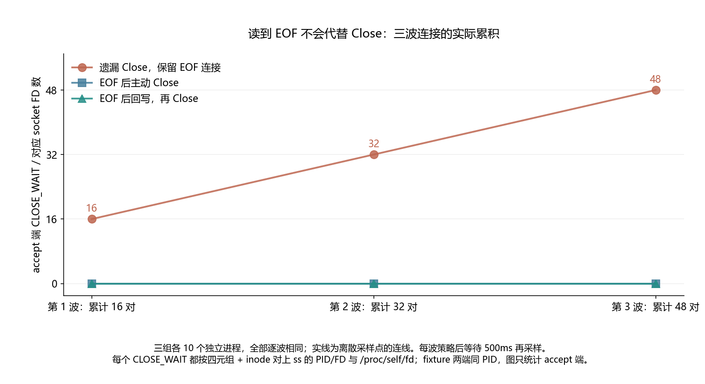

# 020 · CLOSE_WAIT 越来越多，该改内核参数还是先查 close？

远端关闭后本端未关闭怎样影响连接状态？

## 实验方法

peer CloseWrite、accept 实际EOF；三波16对TCP，同PID双端；三策略各十容器，360份ss/proc/inode/FD交叉核验与真实回写/关闭。

## 环境

Python 3.12；PowerShell 7。

Docker Engine 的 Linux 容器模式及 Docker Compose。

## 运行

在仓库根打开 PowerShell，按顺序执行：

~~~powershell
cd labs/020-tcp-close-wait
./scripts/start.ps1
./scripts/reproduce.ps1
./scripts/cleanup.ps1
~~~

目录内另提供 scripts/reproduce.sh；以脚本所需的系统和工具为准。

每次运行生成新的 results 子目录，包含 stdout、stderr、环境信息和校验清单；这些本机输出默认由 Git 忽略。预期的错误退出由实验验证器判定，不能只凭子进程退出码判断修复是否成立。

## 示例结果

三场景各十个真实 Linux 进程，三波 × 每波16对 loopback TCP。遗漏 Close 留下16/32/48条 accept CLOSE_WAIT；立即 Close 与实际回写后 Close 每波0。两端同PID、socket不同；故障结束后双方均清理，最终socket FD/CLOSE_WAIT0、TIME_WAIT48。

图与 CSV 来自一次固定环境中的历史运行，供理解对照关系；新运行的精确时间、PID、内存和调度数据可能不同。此目录的复现入口会执行新的实验，不依赖历史原始日志。

## 代码入口

- [实现与领域验证](src)
- [实验入口](scripts/reproduce.ps1)
- [容器配置](docker-compose.yml)

清理脚本只作用于本实验的进程、容器、集群或工作目录；请先阅读脚本。实验中的固定口令用于本地演示环境。
