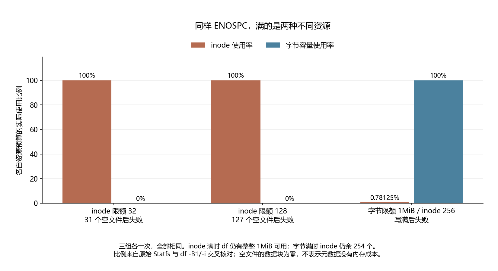

# 022 · df 显示还有空间，创建空文件为什么仍然 No space left？

inode 与字节容量能否独立耗尽？

## 实验方法

受控1MiB tmpfs，inode32/128及bytes256三组各十新容器；真实Open/Write ENOSPC，Statfs/df/FD引用交叉，删4重建4、最后Close后实际写4096。

## 环境

Python 3.12；PowerShell 7。

Docker Engine 的 Linux 容器模式及 Docker Compose。

## 运行

在仓库根打开 PowerShell，按顺序执行：

~~~powershell
cd labs/022-linux-inode-exhaustion
./scripts/start.ps1
./scripts/reproduce.ps1
./scripts/cleanup.ps1
~~~

目录内另提供 scripts/reproduce.sh；以脚本所需的系统和工具为准。

每次运行生成新的 results 子目录，包含 stdout、stderr、环境信息和校验清单；这些本机输出默认由 Git 忽略。预期的错误退出由实验验证器判定，不能只凭子进程退出码判断修复是否成立。

## 示例结果

真实 tmpfs 1MiB，三组各十个新容器。inode32/128创建31/127个立即Close的空文件后真实ENOSPC，字节仍1MiB；删除4个、实际再创建4个成功。字节组写满1MiB后write ENOSPC，却能建空文件；unlink data保留FD时仍满，最后Close恢复并实际写4096成功。

图与 CSV 来自一次固定环境中的历史运行，供理解对照关系；新运行的精确时间、PID、内存和调度数据可能不同。此目录的复现入口会执行新的实验，不依赖历史原始日志。

## 代码入口

- [实现与领域验证](src)
- [实验入口](scripts/reproduce.ps1)
- [容器配置](docker-compose.yml)

清理脚本只作用于本实验的进程、容器、集群或工作目录；请先阅读脚本。实验中的固定口令用于本地演示环境。
