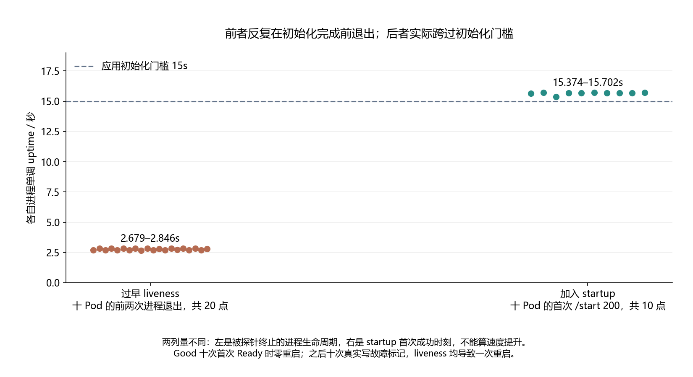

# 023 · 服务一直启动不完，是程序坏了还是探针杀得太早？

liveness 与 startup probe 在慢启动中如何交互？

## 实验方法

真实独立kind，15s时间门槛Go服务；early-live/startup-gated各10新Pod，原probe日志/PodJSON/Events/上一实例SIGTERM及exit交叉，Good真实注入后验证live重启。

## 环境

Python 3.12；PowerShell 7。

Docker Engine 的 Linux 容器模式及 Docker Compose。

kubectl 与 kind 0.31.0；使用独立 kind 集群。将 kind 放在 PATH 中即可。

## 运行

在仓库根打开 PowerShell，按顺序执行：

~~~powershell
cd labs/023-k8s-startup-probe
./scripts/start.ps1
./scripts/reproduce.ps1
./scripts/cleanup.ps1
~~~

目录内另提供 scripts/reproduce.sh；以脚本所需的系统和工具为准。

每次运行生成新的 results 子目录，包含 stdout、stderr、环境信息和校验清单；这些本机输出默认由 Git 忽略。预期的错误退出由实验验证器判定，不能只凭子进程退出码判断修复是否成立。

## 示例结果

真实独立kind0.31.0/K8s1.34.3，Go1.25.4服务固定15s初始化门槛。early-live/startup-gated各十新Pod，前者每Pod实测两次重启/未Ready，后者首次Ready零重启，真实写故障marker后仍被liveness重启。

图与 CSV 来自一次固定环境中的历史运行，供理解对照关系；新运行的精确时间、PID、内存和调度数据可能不同。此目录的复现入口会执行新的实验，不依赖历史原始日志。

## 代码入口

- [实现与领域验证](src)
- [实验入口](scripts/reproduce.ps1)

清理脚本只作用于本实验的进程、容器、集群或工作目录；请先阅读脚本。实验中的固定口令用于本地演示环境。
