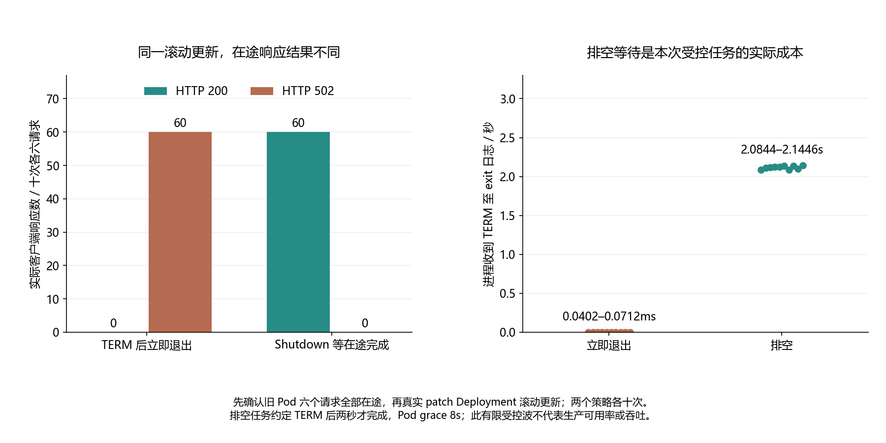

# 024 · 滚动更新时的几次 502，能不能稳定复现出来？

SIGTERM、摘流和在途请求退出如何协调？

## 实验方法

独立真实kind，exit-now/drain各10Deployment/Service/harness；先6真实POST进入旧Pod，patch模板真RollingUpdate，原body/ticket/UID、Pod/RS/EndpointSlice、TERM/Shutdown/exit交叉。

## 环境

Python 3.12；PowerShell 7。

Docker Engine 的 Linux 容器模式及 Docker Compose。

kubectl 与 kind 0.31.0；使用独立 kind 集群。将 kind 放在 PATH 中即可。

## 运行

在仓库根打开 PowerShell，按顺序执行：

~~~powershell
cd labs/024-k8s-graceful-shutdown
./scripts/start.ps1
./scripts/reproduce.ps1
./scripts/cleanup.ps1
~~~

目录内另提供 scripts/reproduce.sh；以脚本所需的系统和工具为准。

每次运行生成新的 results 子目录，包含 stdout、stderr、环境信息和校验清单；这些本机输出默认由 Git 忽略。预期的错误退出由实验验证器判定，不能只凭子进程退出码判断修复是否成立。

## 示例结果

真实kind/K8s1.34.3，先确保六个实际POST进入唯一旧Pod，再patch Deployment模板触发RollingUpdate。exit-now/drain各十trial：立即exit0的旧进程丢响应，60EOF→60HTTP502；Shutdown等待任务完成后exit0，60HTTP200的ticket/value42/oldUID全部匹配。

图与 CSV 来自一次固定环境中的历史运行，供理解对照关系；新运行的精确时间、PID、内存和调度数据可能不同。此目录的复现入口会执行新的实验，不依赖历史原始日志。

## 代码入口

- [实现与领域验证](src)
- [实验入口](scripts/reproduce.ps1)

清理脚本只作用于本实验的进程、容器、集群或工作目录；请先阅读脚本。实验中的固定口令用于本地演示环境。
