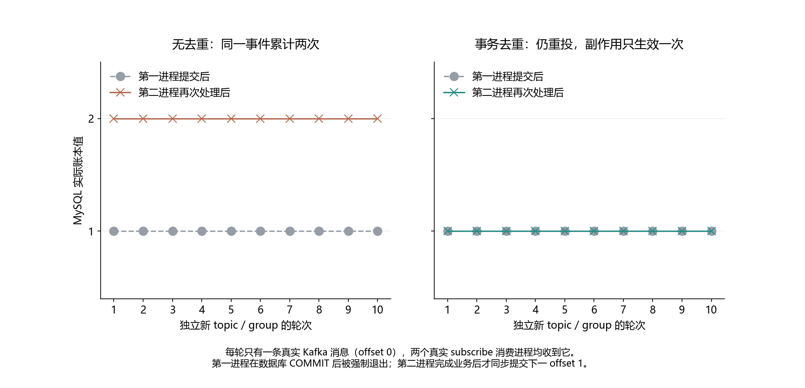

# 025 · 消费者处理成功后突然退出，消息为什么又来了？

业务提交和 offset 提交之间的窗口如何制造重复？

## 实验方法

单分区固定消息；业务落库后 barrier 强制退出，重启同 group；幂等键 Good。

## 环境

Python 3.12；PowerShell 7。

Docker Engine 的 Linux 容器模式及 Docker Compose。

此入口按 Windows x64 / CPython 3.12 整理；部分依赖和进程检查使用 Windows 专用实现。

## 运行

在仓库根打开 PowerShell，按顺序执行：

~~~powershell
cd labs/025-kafka-duplicate-consumption
./scripts/start.ps1
./scripts/reproduce.ps1
./scripts/cleanup.ps1
~~~

每次运行生成新的 results 子目录，包含 stdout、stderr、环境信息和校验清单；这些本机输出默认由 Git 忽略。预期的错误退出由实验验证器判定，不能只凭子进程退出码判断修复是否成立。

## 示例结果

Kafka3.9.1/MySQL8.4.11/confluent-kafka与librdkafka2.11.1。每轮一条真实消息、两个真实subscribe业务进程。no-dedupe/txn-dedupe各十次：两次交付相同offset0，账本最终2/1；第二次业务提交后同步提交nextoffset1并外部回读。去重没有阻止重投，只限制同数据库副作用。

图与 CSV 来自一次固定环境中的历史运行，供理解对照关系；新运行的精确时间、PID、内存和调度数据可能不同。此目录的复现入口会执行新的实验，不依赖历史原始日志。

## 代码入口

- [实验入口](scripts/reproduce.ps1)
- [SQL](sql)
- [容器配置](docker-compose.yml)

清理脚本只作用于本实验的进程、容器、集群或工作目录；请先阅读脚本。实验中的固定口令用于本地演示环境。
