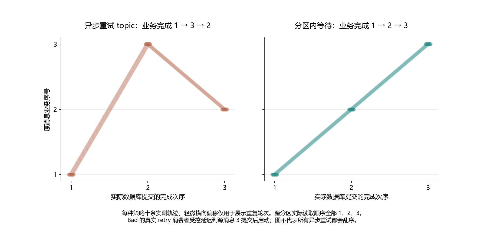

# 026 · 消息都在同一分区，重试后为什么业务顺序还是乱了？

失败转移到重试队列会否打乱业务顺序？

## 实验方法

同 key 序列消息，第二条故意失败；跳过异步重试与分区阻塞重试对照。

## 环境

Python 3.12；PowerShell 7。

Docker Engine 的 Linux 容器模式及 Docker Compose。

此入口按 Windows x64 / CPython 3.12 整理；部分依赖和进程检查使用 Windows 专用实现。

先在仓库根执行 python labs/025-kafka-duplicate-consumption/scripts/bootstrap.py，安装共用 Kafka Python 环境。

## 运行

在仓库根打开 PowerShell，按顺序执行：

~~~powershell
cd labs/026-kafka-retry-order
./scripts/start.ps1
./scripts/reproduce.ps1
./scripts/cleanup.ps1
~~~

每次运行生成新的 results 子目录，包含 stdout、stderr、环境信息和校验清单；这些本机输出默认由 Git 忽略。预期的错误退出由实验验证器判定，不能只凭子进程退出码判断修复是否成立。

## 示例结果

真实Kafka3.9.1/MySQL8.4.11/native client2.11.1；每轮同key三条输入seq1/2/3，源实际读取均1/2/3，seq2首次真实SQL1644。async-retry-topic/partition-block各十：业务最终1/3/2或1/2/3，计数均3。异步retryworker受控延迟到源3完成后启动，这是可复现调度条件，非随机自然发生概率。

图与 CSV 来自一次固定环境中的历史运行，供理解对照关系；新运行的精确时间、PID、内存和调度数据可能不同。此目录的复现入口会执行新的实验，不依赖历史原始日志。

## 代码入口

- [实验入口](scripts/reproduce.ps1)
- [SQL](sql)
- [容器配置](docker-compose.yml)

清理脚本只作用于本实验的进程、容器、集群或工作目录；请先阅读脚本。实验中的固定口令用于本地演示环境。
