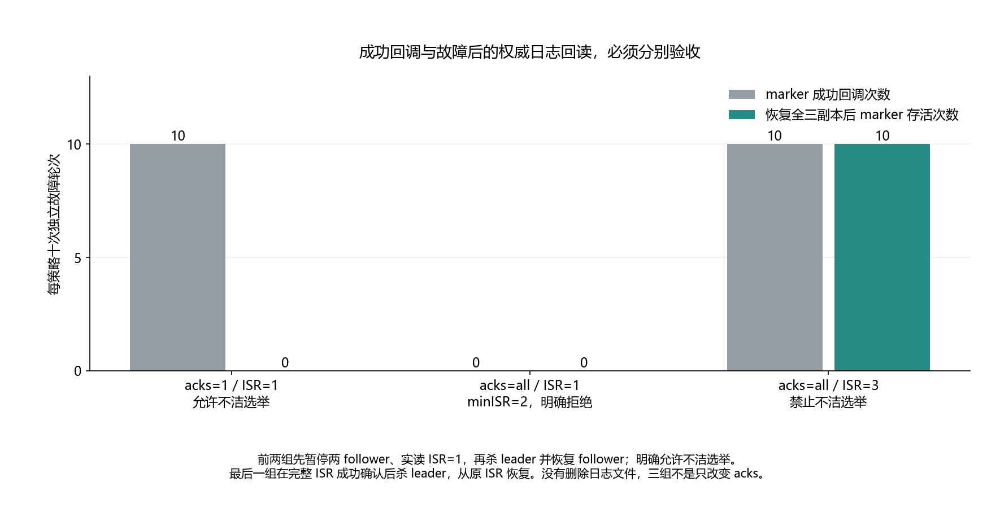

# 027 · 生产者收到成功，就能保证故障后消息还在吗？

acks、ISR 和副本故障边界怎样影响持久性？

## 实验方法

三broker加专用controller；实际pause至ISR1/kill leader/选举恢复；acks1本地成功、all不足拒绝、完整ISR确认后保留，各十次。

## 环境

Python 3.12；PowerShell 7。

Docker Engine 的 Linux 容器模式及 Docker Compose。

此入口按 Windows x64 / CPython 3.12 整理；部分依赖和进程检查使用 Windows 专用实现。

先在仓库根执行 python labs/025-kafka-duplicate-consumption/scripts/bootstrap.py，安装共用 Kafka Python 环境。

## 运行

在仓库根打开 PowerShell，按顺序执行：

~~~powershell
cd labs/027-kafka-acks-failure
./scripts/start.ps1
./scripts/reproduce.ps1
./scripts/cleanup.ps1
~~~

每次运行生成新的 results 子目录，包含 stdout、stderr、环境信息和校验清单；这些本机输出默认由 Git 忽略。预期的错误退出由实验验证器判定，不能只凭子进程退出码判断修复是否成立。

## 示例结果

真实 Kafka 3.9.1，三 broker 加专用单 controller，native client/librdkafka 2.11.1。三个场景各十轮：acks1/ISR1/unclean 成功10、恢复 marker0；all/ISR1/min2 明确拒绝10；all/ISR3/clean 成功10、恢复 marker10。第二组不是已确认消息丢失，三组不是只变 acks。每轮全三 ISR 恢复后才进入下一轮。

图与 CSV 来自一次固定环境中的历史运行，供理解对照关系；新运行的精确时间、PID、内存和调度数据可能不同。此目录的复现入口会执行新的实验，不依赖历史原始日志。

## 代码入口

- [实验入口](scripts/reproduce.ps1)
- [容器配置](docker-compose.yml)

清理脚本只作用于本实验的进程、容器、集群或工作目录；请先阅读脚本。实验中的固定口令用于本地演示环境。
