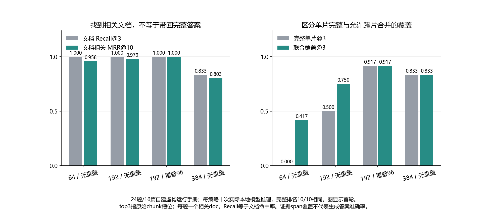

# 028 · Chunk 切得更大，RAG 召回就一定更好吗？

切片大小怎样影响带标注语料的检索覆盖？

## 实验方法

16篇自建虚构中文手册/24人工qrels；固定本地BGE revision真实CPU推理；四char/overlap各十，docRecall/MRR及单片/联合span覆盖和重复上下文。

## 环境

Python 3.12；PowerShell 7。

此入口按 Windows x64 / CPython 3.12 整理；部分依赖和进程检查使用 Windows 专用实现。

首次 setup 需要联网下载固定 revision 的 BGE 模型及 CPU 推理依赖；模型和缓存不会进入 Git。已有共用环境时直接复现，勿重复执行首次安装。

## 运行

在仓库根打开 PowerShell，按顺序执行：

~~~powershell
cd labs/028-rag-chunk-recall
./scripts/start.ps1
./scripts/reproduce.ps1
./scripts/cleanup.ps1
~~~

每次运行生成新的 results 子目录，包含 stdout、stderr、环境信息和校验清单；这些本机输出默认由 Git 忽略。预期的错误退出由实验验证器判定，不能只凭子进程退出码判断修复是否成立。

## 示例结果

真实BGE-small-zh-v1.5固定revision/CPU模型推理；16篇自建虚构手册/4598字符，24人工qrels在首次推理前冻结。64/0、192/0、192/96、384/0各十：docRecall3为1/1/1/.8333，联合证据覆盖为10/18/22/20题（共24）。结果支持本fixture边界与排名差异，非通用最优chunk或生成准确率；overlap有q06退步，q08仍漏。

图与 CSV 来自一次固定环境中的历史运行，供理解对照关系；新运行的精确时间、PID、内存和调度数据可能不同。此目录的复现入口会执行新的实验，不依赖历史原始日志。

## 代码入口

- [实现与领域验证](src)
- [实验入口](scripts/reproduce.ps1)
- [固定输入](data)

清理脚本只作用于本实验的进程、容器、集群或工作目录；请先阅读脚本。实验中的固定口令用于本地演示环境。
