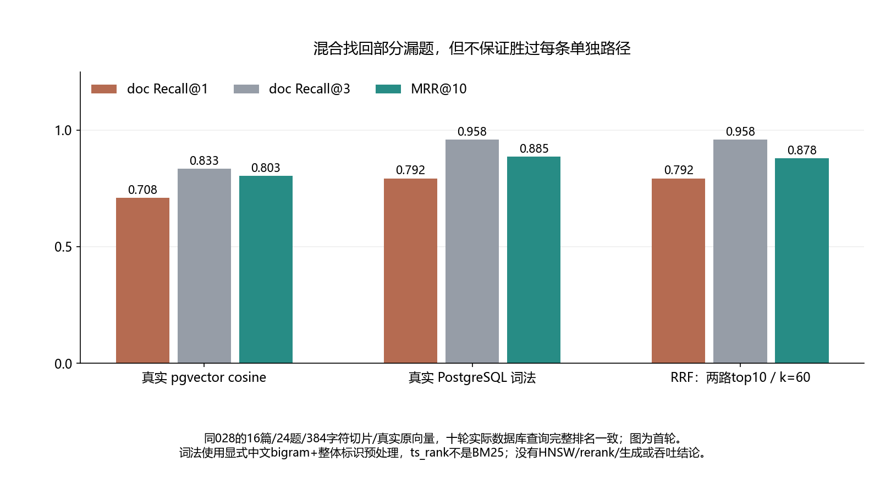

# 029 · 语义检索漏了错误码，混合检索能找回来吗？

向量召回与词法召回的错误是否互补？

## 实验方法

固定028 char384/0原语料/模型/qrels/真实向量；PG精确cosine、显式bigram/标识词法、RRFtop10/k60各十；逐题互补及退步。

## 环境

Python 3.12；PowerShell 7。

Docker Engine 的 Linux 容器模式及 Docker Compose。

此入口按 Windows x64 / CPython 3.12 整理；部分依赖和进程检查使用 Windows 专用实现。

固定语料、标注及真实 float32 向量已随仓库提供；本实验无需再次下载 embedding 模型。

## 运行

在仓库根打开 PowerShell，按顺序执行：

~~~powershell
cd labs/029-rag-hybrid-search
./scripts/start.ps1
./scripts/reproduce.ps1
./scripts/cleanup.ps1
~~~

每次运行生成新的 results 子目录，包含 stdout、stderr、环境信息和校验清单；这些本机输出默认由 Git 忽略。预期的错误退出由实验验证器判定，不能只凭子进程退出码判断修复是否成立。

## 示例结果

真实PostgreSQL17.10/pgvector0.8.2，三路径各十/30case。复用028正式V2 char384/0原16chunk、真512dim向量/24qrels。vector Recall3 20/24，lexical和RRF23/24；lexical漏q04，RRF漏q08，MRR .8032/.8854/.8785。混合找回三向量漏题但不保证优于单路；诊断已知失败场景，不是盲测生产评估。

图与 CSV 来自一次固定环境中的历史运行，供理解对照关系；新运行的精确时间、PID、内存和调度数据可能不同。此目录的复现入口会执行新的实验，不依赖历史原始日志。

## 代码入口

- [实现与领域验证](src)
- [实验入口](scripts/reproduce.ps1)
- [固定输入](data)
- [容器配置](docker-compose.yml)

清理脚本只作用于本实验的进程、容器、集群或工作目录；请先阅读脚本。实验中的固定口令用于本地演示环境。
