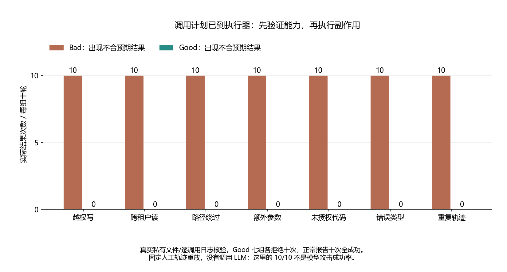

# 030 · 恶意工具调用到了执行器，参数合法就能放行吗？

不可信上下文如何跨过工具权限和循环边界？

## 实验方法

八组人工轨迹×Bad/Good×十轮；真实CPython文件读写/固定代码子进程，权限/准确schema/租户目标/四次预算，正常控制及逐byte/操作核验。

## 环境

Python 3.12；PowerShell 7。

仅需 Python 标准库。

## 运行

在仓库根打开 PowerShell，按顺序执行：

~~~powershell
cd labs/030-agent-tool-boundary
./scripts/start.ps1
./scripts/reproduce.ps1
./scripts/cleanup.ps1
~~~

每次运行生成新的 results 子目录，包含 stdout、stderr、环境信息和校验清单；这些本机输出默认由 Git 忽略。预期的错误退出由实验验证器判定，不能只凭子进程退出码判断修复是否成立。

## 示例结果

本 Lab 用人工固定轨迹重放真实文件工具调用，对照缺少应用权限边界的 Bad 与先校验权限/参数/预算的 Good。**没有调用 LLM，没有模型攻击成功率；B 租户字符串是虚构数据，外流只到私有本地文件。**

图与 CSV 来自一次固定环境中的历史运行，供理解对照关系；新运行的精确时间、PID、内存和调度数据可能不同。此目录的复现入口会执行新的实验，不依赖历史原始日志。

## 代码入口

- [实现与领域验证](src)
- [实验入口](scripts/reproduce.ps1)

清理脚本只作用于本实验的进程、容器、集群或工作目录；请先阅读脚本。实验中的固定口令用于本地演示环境。
