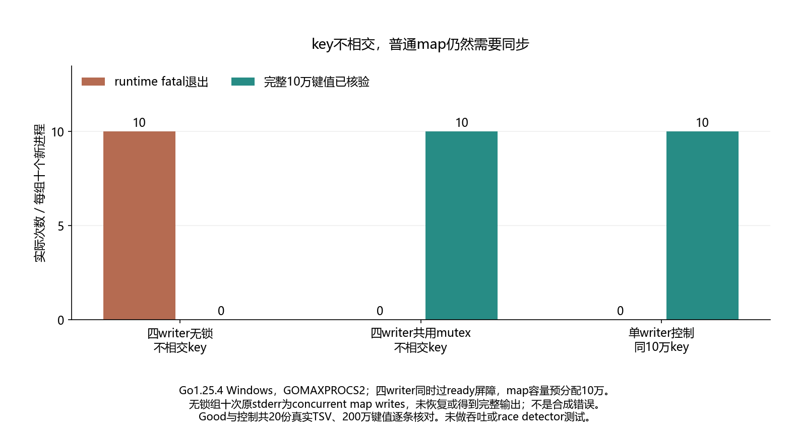

# 033 · map的key都不同，为什么并发写仍然fatal？

不同key是否允许无同步写普通map？

## 实验方法

固定多writer屏障，Bad/MutexGood各十进程，真实fatal及最终完整键集。

## 环境

Python 3.12；PowerShell 7。

Go 1.25.4 或兼容版本；脚本会记录实际版本。

## 运行

在仓库根打开 PowerShell，按顺序执行：

~~~powershell
cd labs/033-go-concurrent-map
./scripts/start.ps1
./scripts/reproduce.ps1
./scripts/cleanup.ps1
~~~

每次运行生成新的 results 子目录，包含 stdout、stderr、环境信息和校验清单；这些本机输出默认由 Git 忽略。预期的错误退出由实验验证器判定，不能只凭子进程退出码判断修复是否成立。

## 示例结果

Go1.25.4 Windows/amd64，GOMAXPROCS2，四writer各25000个不相交整数key。无锁十次concurrent map writes fatal；mutex十次及单writer控制十次全部得到完整100000键值。

图与 CSV 来自一次固定环境中的历史运行，供理解对照关系；新运行的精确时间、PID、内存和调度数据可能不同。此目录的复现入口会执行新的实验，不依赖历史原始日志。

该实现的历史数据来自 Windows/amd64；未据此声明 Linux 环境得到同一组数值。

## 代码入口

- [实现与领域验证](src)
- [实验入口](scripts/reproduce.ps1)

清理脚本只作用于本实验的进程、容器、集群或工作目录；请先阅读脚本。实验中的固定口令用于本地演示环境。
