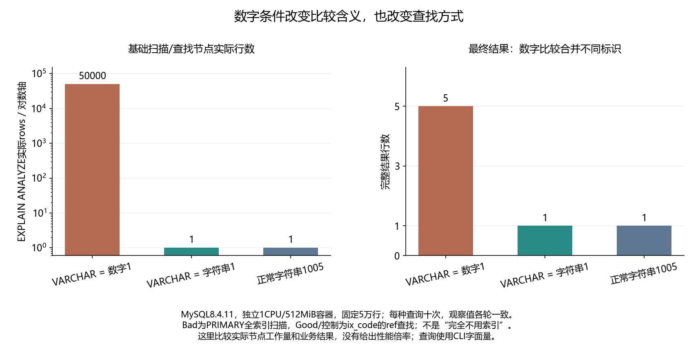

# 036 · 查字符串列时传了数字，为什么结果和索引都变了？

类型转换是否改变比较语义和访问路径？

## 实验方法

50k真实VARCHAR fixture，数字/字符串/正常字符串字面量各十；完整HEX元组/warning/JSON及TREE实际基础节点。

## 环境

Python 3.12；PowerShell 7。

Docker Engine 的 Linux 容器模式及 Docker Compose。

## 运行

在仓库根打开 PowerShell，按顺序执行：

~~~powershell
cd labs/036-mysql-implicit-conversion
./scripts/start.ps1
./scripts/reproduce.ps1
./scripts/cleanup.ps1
~~~

每次运行生成新的 results 子目录，包含 stdout、stderr、环境信息和校验清单；这些本机输出默认由 Git 忽略。预期的错误退出由实验验证器判定，不能只凭子进程退出码判断修复是否成立。

## 示例结果

MySQL8.4.11固定digest，真实50k行/ix_code。数字字面量1返回五种文本并PRIMARY全扫描50000；字符串'1'及正常'1005'各返回一行/ix_code ref lookup1。各十次，语义和工作量分别验证。

图与 CSV 来自一次固定环境中的历史运行，供理解对照关系；新运行的精确时间、PID、内存和调度数据可能不同。此目录的复现入口会执行新的实验，不依赖历史原始日志。

## 代码入口

- [实现与领域验证](src)
- [实验入口](scripts/reproduce.ps1)
- [SQL](sql)
- [容器配置](docker-compose.yml)

清理脚本只作用于本实验的进程、容器、集群或工作目录；请先阅读脚本。实验中的固定口令用于本地演示环境。
