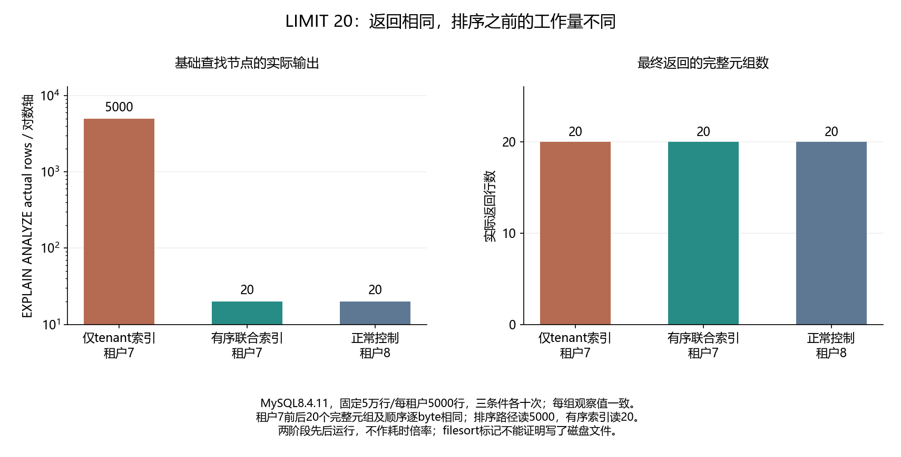

# 037 · LIMIT只要20行，MySQL为什么仍要排序更多数据？

LIMIT和匹配排序索引分别减少什么工作？

## 实验方法

50k数据tenant各5000，Bad仅tenant索引十次，再真实ADD排序复合索引Good/另一tenant控制各十，完整元组和前后数据校验，真JSON/TREE。

## 环境

Python 3.12；PowerShell 7。

Docker Engine 的 Linux 容器模式及 Docker Compose。

## 运行

在仓库根打开 PowerShell，按顺序执行：

~~~powershell
cd labs/037-mysql-order-limit-sort
./scripts/start.ps1
./scripts/reproduce.ps1
./scripts/cleanup.ps1
~~~

每次运行生成新的 results 子目录，包含 stdout、stderr、环境信息和校验清单；这些本机输出默认由 Git 忽略。预期的错误退出由实验验证器判定，不能只凭子进程退出码判断修复是否成立。

## 示例结果

MySQL8.4.11真实5万行、每租户5000行。仅tenant索引先读5000再排序取20；实际添加(tenant_id,created_at DESC,id DESC)后读20。租户7前后完整20元组及顺序相同；租户8正常控制独立核对，各十次。

图与 CSV 来自一次固定环境中的历史运行，供理解对照关系；新运行的精确时间、PID、内存和调度数据可能不同。此目录的复现入口会执行新的实验，不依赖历史原始日志。

## 代码入口

- [实现与领域验证](src)
- [实验入口](scripts/reproduce.ps1)
- [SQL](sql)
- [容器配置](docker-compose.yml)

清理脚本只作用于本实验的进程、容器、集群或工作目录；请先阅读脚本。实验中的固定口令用于本地演示环境。
