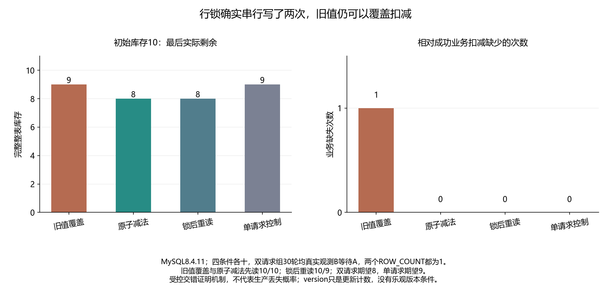

# 038 · 两个请求都返回成功，库存为什么只扣了一次？

读后写旧值与原子更新/锁内重读的并发契约有何不同？

## 实验方法

双真实持续事务及第三观察连接，实际data_lock_waits屏障；旧值SET/原子减法/锁后重读/单请求控制各十，完整库存/版本/SQL/时序。

## 环境

Python 3.12；PowerShell 7。

Docker Engine 的 Linux 容器模式及 Docker Compose。

## 运行

在仓库根打开 PowerShell，按顺序执行：

~~~powershell
cd labs/038-mysql-lost-update
./scripts/start.ps1
./scripts/reproduce.ps1
./scripts/cleanup.ps1
~~~

每次运行生成新的 results 子目录，包含 stdout、stderr、环境信息和校验清单；这些本机输出默认由 Git 忽略。预期的错误退出由实验验证器判定，不能只凭子进程退出码判断修复是否成立。

## 示例结果

MySQL8.4.11四条件各十；双业务会话和观察会话均真实持续CLI。Bad两次写ROW_COUNT1/version2，却最终库存9；atomic与锁后重读最终8；单请求控制9。前三组每轮data_lock_waits确实见到B等待A。

图与 CSV 来自一次固定环境中的历史运行，供理解对照关系；新运行的精确时间、PID、内存和调度数据可能不同。此目录的复现入口会执行新的实验，不依赖历史原始日志。

## 代码入口

- [实现与领域验证](src)
- [实验入口](scripts/reproduce.ps1)
- [SQL](sql)
- [容器配置](docker-compose.yml)

清理脚本只作用于本实验的进程、容器、集群或工作目录；请先阅读脚本。实验中的固定口令用于本地演示环境。
