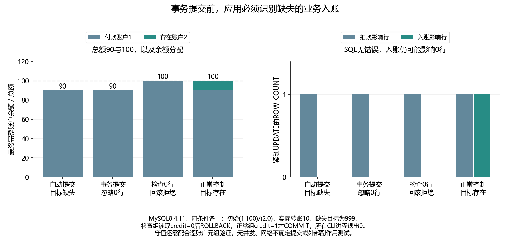

# 039 · 事务正常COMMIT，转账为什么仍然少了钱？

零行UPDATE是否算SQL失败，事务能否自动检查业务契约？

## 实验方法

真实持续CLI，缺失收款人id999：autocommit/事务忽略0/检查0回滚/存在目标正常各十；两账户完整元组/ROW_COUNT/总额/决策。

## 环境

Python 3.12；PowerShell 7。

Docker Engine 的 Linux 容器模式及 Docker Compose。

## 运行

在仓库根打开 PowerShell，按顺序执行：

~~~powershell
cd labs/039-mysql-zero-row-transfer
./scripts/start.ps1
./scripts/reproduce.ps1
./scripts/cleanup.ps1
~~~

每次运行生成新的 results 子目录，包含 stdout、stderr、环境信息和校验清单；这些本机输出默认由 Git 忽略。预期的错误退出由实验验证器判定，不能只凭子进程退出码判断修复是否成立。

## 示例结果

真实MySQL8.4.11：转账10至不存在id999，入账UPDATE影响0行/无SQL错误。自动提交与事务忽略0均留下90/0；检查0再回滚保留100/0；正常目标2得到90/10。四组各十。

图与 CSV 来自一次固定环境中的历史运行，供理解对照关系；新运行的精确时间、PID、内存和调度数据可能不同。此目录的复现入口会执行新的实验，不依赖历史原始日志。

## 代码入口

- [实现与领域验证](src)
- [实验入口](scripts/reproduce.ps1)
- [SQL](sql)
- [容器配置](docker-compose.yml)

清理脚本只作用于本实验的进程、容器、集群或工作目录；请先阅读脚本。实验中的固定口令用于本地演示环境。
