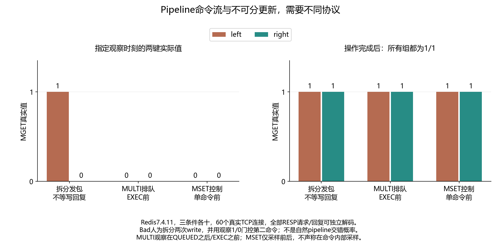

# 040 · 用了Pipeline，为什么中间状态还会被别的请求看到？

Pipeline减少往返是否同时提供原子执行？

## 实验方法

真实原始RESP两连接，明确拆分发包pipeline观察1/0；MULTI排队观察0/0及MSET单命令正常控制，各十，完整wire/时序/最终1/1。

## 环境

Python 3.12；PowerShell 7。

Docker Engine 的 Linux 容器模式及 Docker Compose。

## 运行

在仓库根打开 PowerShell，按顺序执行：

~~~powershell
cd labs/040-redis-pipeline-interleaving
./scripts/start.ps1
./scripts/reproduce.ps1
./scripts/cleanup.ps1
~~~

每次运行生成新的 results 子目录，包含 stdout、stderr、环境信息和校验清单；这些本机输出默认由 Git 忽略。预期的错误退出由实验验证器判定，不能只凭子进程退出码判断修复是否成立。

## 示例结果

Redis7.4.11原始RESP两TCP连接，三条件各十。明确拆分发包、不读写回复的pipeline观察到1/0；MULTI确认QUEUED后/EXEC前观察0/0，执行后1/1；正常MSET单命令控制最终1/1。

图与 CSV 来自一次固定环境中的历史运行，供理解对照关系；新运行的精确时间、PID、内存和调度数据可能不同。此目录的复现入口会执行新的实验，不依赖历史原始日志。

## 代码入口

- [实现与领域验证](src)
- [实验入口](scripts/reproduce.ps1)
- [容器配置](docker-compose.yml)

清理脚本只作用于本实验的进程、容器、集群或工作目录；请先阅读脚本。实验中的固定口令用于本地演示环境。
