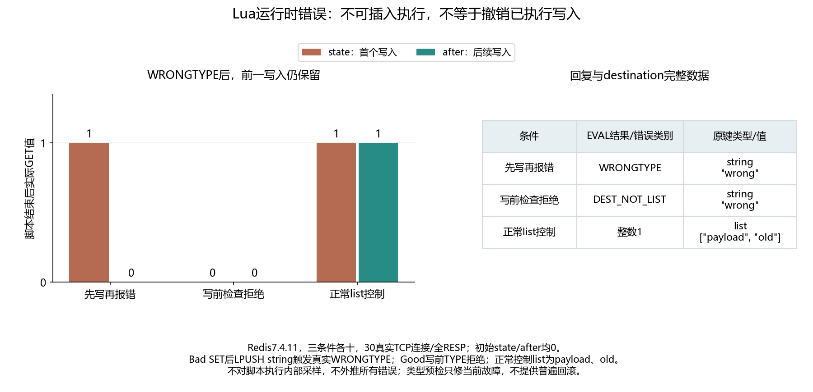

# 041 · Lua脚本报错了，前面写进去的值为什么还在？

Redis脚本原子执行是否等于错误时回滚？

## 实验方法

真实EVAL SET后LPUSH类型错误；写前TYPE拒绝与正常list控制各十；独立解码全RESP/脚本文本SHA1/完整前后键类型值。

## 环境

Python 3.12；PowerShell 7。

Docker Engine 的 Linux 容器模式及 Docker Compose。

## 运行

在仓库根打开 PowerShell，按顺序执行：

~~~powershell
cd labs/041-redis-lua-no-rollback
./scripts/start.ps1
./scripts/reproduce.ps1
./scripts/cleanup.ps1
~~~

每次运行生成新的 results 子目录，包含 stdout、stderr、环境信息和校验清单；这些本机输出默认由 Git 忽略。预期的错误退出由实验验证器判定，不能只凭子进程退出码判断修复是否成立。

## 示例结果

Redis7.4.11三组各十。Bad SET state1之后LPUSH string实际WRONGTYPE，state1保留/after0；Good写前TYPE返回DEST_NOT_LIST，两个标记保持0；正常list成功，两个标记1/list完整payload,old。

图与 CSV 来自一次固定环境中的历史运行，供理解对照关系；新运行的精确时间、PID、内存和调度数据可能不同。此目录的复现入口会执行新的实验，不依赖历史原始日志。

## 代码入口

- [实现与领域验证](src)
- [实验入口](scripts/reproduce.ps1)
- [容器配置](docker-compose.yml)

清理脚本只作用于本实验的进程、容器、集群或工作目录；请先阅读脚本。实验中的固定口令用于本地演示环境。
