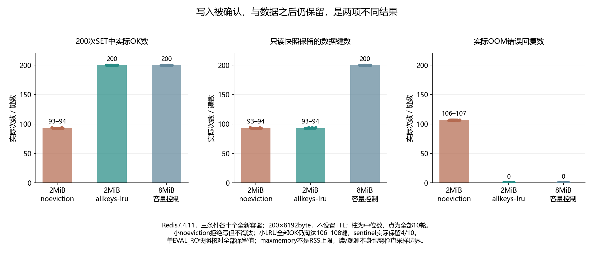

# 042 · 写入没有报错，旧key为什么自己不见了？

maxmemory淘汰策略如何影响写入与保留契约？

## 实验方法

30新隔离容器：2MiB noeviction/allkeys-lru与8MiB控制各十；200真实8KiB SET回复、全保留键值/INFO淘汰/expired/PTTL核对。

## 环境

Python 3.12；PowerShell 7。

Docker Engine 的 Linux 容器模式及 Docker Compose。

## 运行

在仓库根打开 PowerShell，按顺序执行：

~~~powershell
cd labs/042-redis-maxmemory-eviction
./scripts/reproduce.ps1
~~~

每次运行生成新的 results 子目录，包含 stdout、stderr、环境信息和校验清单；这些本机输出默认由 Git 忽略。预期的错误退出由实验验证器判定，不能只凭子进程退出码判断修复是否成立。

## 示例结果

Redis7.4.11每trial新容器：2MiB noeviction、2MiB allkeys-lru、8MiB noeviction容量控制各十。每轮200×8192byte SET。小noeviction真实OOM106–107次/保留已成功写入；LRU全200 OK但快照仅93–94数据键；容量控制全200 OK且保留200。

图与 CSV 来自一次固定环境中的历史运行，供理解对照关系；新运行的精确时间、PID、内存和调度数据可能不同。此目录的复现入口会执行新的实验，不依赖历史原始日志。

## 代码入口

- [实现与领域验证](src)
- [实验入口](scripts/reproduce.ps1)

清理脚本只作用于本实验的进程、容器、集群或工作目录；请先阅读脚本。实验中的固定口令用于本地演示环境。
