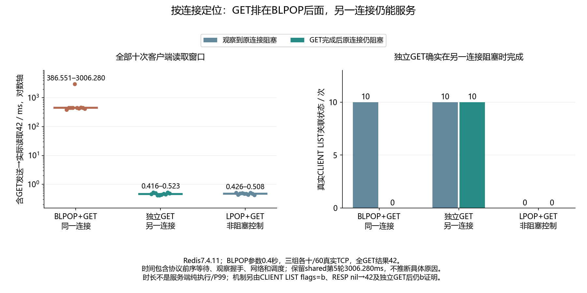

# 043 · Redis明明不忙，GET为什么排在BLPOP后面？

阻塞命令与同一连接的后续命令如何相互影响？

## 实验方法

真实双RESP连接，BLPOP0.4+GET同连接/独立GET/非阻塞LPOP控制各十；CLIENT LIST关联真实flagsb、全wire顺序/GET42与等待耗时。

## 环境

Python 3.12；PowerShell 7。

Docker Engine 的 Linux 容器模式及 Docker Compose。

## 运行

在仓库根打开 PowerShell，按顺序执行：

~~~powershell
cd labs/043-redis-blocking-connection
./scripts/start.ps1
./scripts/reproduce.ps1
./scripts/cleanup.ps1
~~~

每次运行生成新的 results 子目录，包含 stdout、stderr、环境信息和校验清单；这些本机输出默认由 Git 忽略。预期的错误退出由实验验证器判定，不能只凭子进程退出码判断修复是否成立。

## 示例结果

Redis7.4.11三组各十/60TCP：同连接BLPOP0.4+GET依次收到nil-array/42；独立GET返回42后CLIENT LIST仍见原连接flagsb/cmdblpop；非阻塞LPOP控制nil-bulk/42。所有真实输入/回复/服务端连接状态保存。

图与 CSV 来自一次固定环境中的历史运行，供理解对照关系；新运行的精确时间、PID、内存和调度数据可能不同。此目录的复现入口会执行新的实验，不依赖历史原始日志。

## 代码入口

- [实现与领域验证](src)
- [实验入口](scripts/reproduce.ps1)
- [容器配置](docker-compose.yml)

清理脚本只作用于本实验的进程、容器、集群或工作目录；请先阅读脚本。实验中的固定口令用于本地演示环境。
