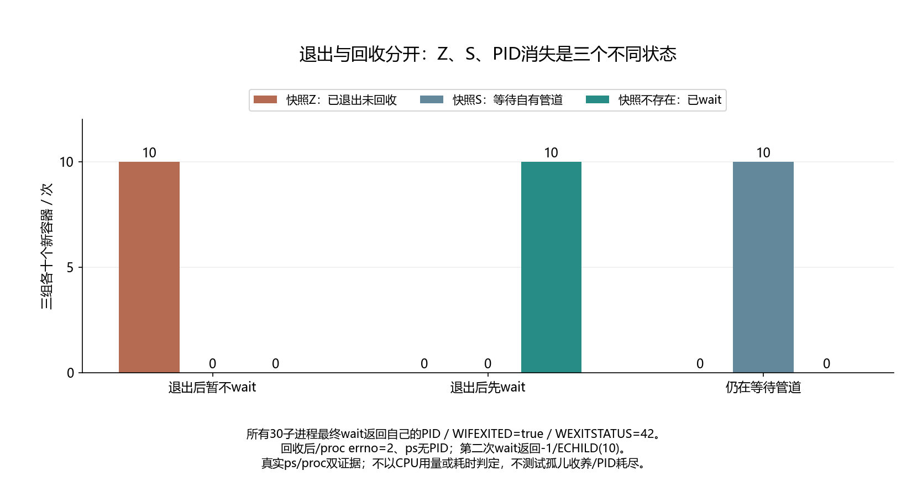

# 044 · 子进程已经退出，为什么ps里还留着Z？

进程退出与父进程回收有什么差别？

## 实验方法

受控fork/exit，wait前后ps/proc/waitpid，三组各十容器。

## 环境

Python 3.12；PowerShell 7。

Docker Engine 的 Linux 容器模式及 Docker Compose。

## 运行

在仓库根打开 PowerShell，按顺序执行：

~~~powershell
cd labs/044-linux-zombie-wait
./scripts/reproduce.ps1
./scripts/cleanup.ps1
~~~

每次运行生成新的 results 子目录，包含 stdout、stderr、环境信息和校验清单；这些本机输出默认由 Git 忽略。预期的错误退出由实验验证器判定，不能只凭子进程退出码判断修复是否成立。

## 示例结果

Linux专用父子进程，三个条件各十新容器：暂不wait快照Z；先wait快照不存在；活子等待管道快照S。全部最终wait取得42，之后/proc ENOENT、ps无该PID、二次wait ECHILD。

图与 CSV 来自一次固定环境中的历史运行，供理解对照关系；新运行的精确时间、PID、内存和调度数据可能不同。此目录的复现入口会执行新的实验，不依赖历史原始日志。

## 代码入口

- [实现与领域验证](src)
- [实验入口](scripts/reproduce.ps1)

清理脚本只作用于本实验的进程、容器、集群或工作目录；请先阅读脚本。实验中的固定口令用于本地演示环境。
