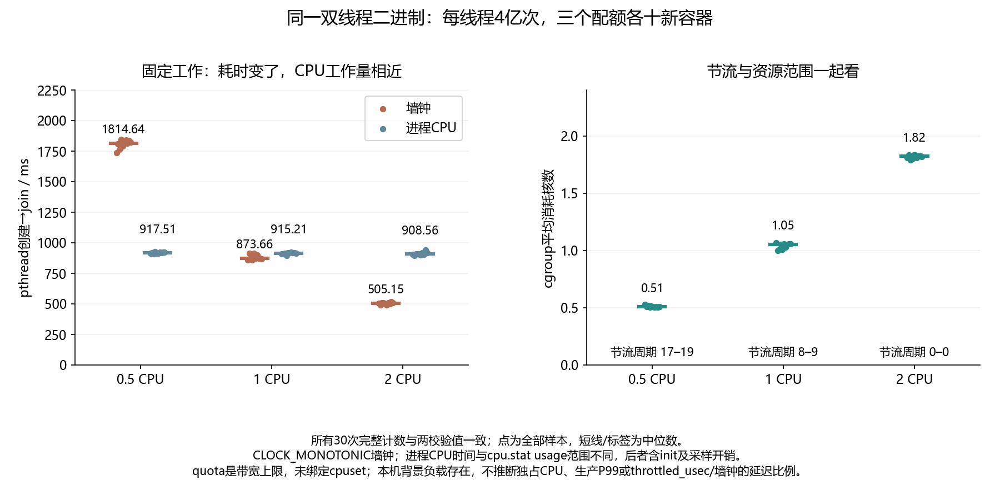

# 045 · CPU limit设成半核，为什么任务耗时不止看CPU百分比？

固定计算工作下quota与throttling如何影响墙钟？

## 实验方法

同二进制固定迭代0.5/1/2quota各十新容器，cgroup cpu.stat与结果校验。

## 环境

Python 3.12；PowerShell 7。

Docker Engine 的 Linux 容器模式及 Docker Compose。

## 运行

在仓库根打开 PowerShell，按顺序执行：

~~~powershell
cd labs/045-docker-cpu-throttling
./scripts/reproduce.ps1
./scripts/cleanup.ps1
~~~

每次运行生成新的 results 子目录，包含 stdout、stderr、环境信息和校验清单；这些本机输出默认由 Git 忽略。预期的错误退出由实验验证器判定，不能只凭子进程退出码判断修复是否成立。

## 示例结果

同一C双线程二进制，每线程4亿次依赖计算；0.5/1/2 CPU各十新容器。全部完整计数/校验值一致，墙钟中位1814.636/873.659/505.155ms，进程CPU约0.9秒；节流周期分别17–19/8–9/0。原cpu.stat六项增量与真实资源保存。

图与 CSV 来自一次固定环境中的历史运行，供理解对照关系；新运行的精确时间、PID、内存和调度数据可能不同。此目录的复现入口会执行新的实验，不依赖历史原始日志。

## 代码入口

- [实现与领域验证](src)
- [实验入口](scripts/reproduce.ps1)

清理脚本只作用于本实验的进程、容器、集群或工作目录；请先阅读脚本。实验中的固定口令用于本地演示环境。
