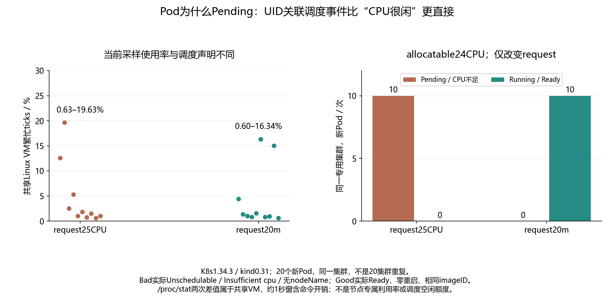

# 046 · 节点CPU很闲，Pod为什么仍然Pending？

调度requests与即时CPU使用率是否同一指标？

## 实验方法

独立kind，高于allocatable的request与合理request各十新Pod，Events/Pod/节点allocatable。

## 环境

Python 3.12；PowerShell 7。

Docker Engine 的 Linux 容器模式及 Docker Compose。

kubectl 与 kind 0.31.0；使用独立 kind 集群。将 kind 放在 PATH 中即可。

## 运行

在仓库根打开 PowerShell，按顺序执行：

~~~powershell
cd labs/046-k8s-unschedulable-request
./scripts/reproduce.ps1
./scripts/cleanup.ps1
~~~

每次运行生成新的 results 子目录，包含 stdout、stderr、环境信息和校验清单；这些本机输出默认由 Git 忽略。预期的错误退出由实验验证器判定，不能只凭子进程退出码判断修复是否成立。

## 示例结果

专用kind1.34.3单节点allocatable24CPU，25CPU request十Pod均Pending/Unschedulable/Insufficient cpu，无nodeName；20m request十Pod均Running/Ready，零重启，同imageID。真实VM繁忙率低于20%，口径不等于scheduler可用资源。

图与 CSV 来自一次固定环境中的历史运行，供理解对照关系；新运行的精确时间、PID、内存和调度数据可能不同。此目录的复现入口会执行新的实验，不依赖历史原始日志。

## 代码入口

- [实现与领域验证](src)
- [实验入口](scripts/reproduce.ps1)

清理脚本只作用于本实验的进程、容器、集群或工作目录；请先阅读脚本。实验中的固定口令用于本地演示环境。
