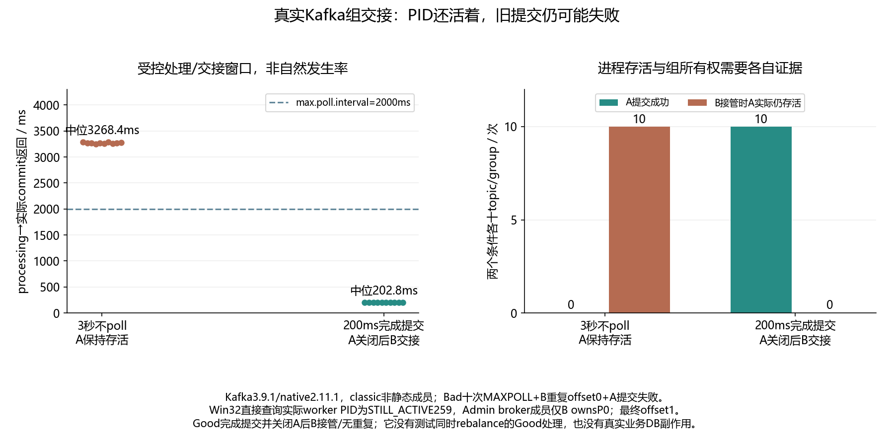

# 047 · 消费者还活着，为什么分区已经分给别人？

业务停顿超过max.poll.interval时心跳与组所有权有何边界？

## 实验方法

两个真实subscribe进程，受控慢处理；超间隔与有限处理Good各十，member/assignment/commit error。

## 环境

Python 3.12；PowerShell 7。

Docker Engine 的 Linux 容器模式及 Docker Compose。

此入口按 Windows x64 / CPython 3.12 整理；部分依赖和进程检查使用 Windows 专用实现。

先在仓库根执行 python labs/025-kafka-duplicate-consumption/scripts/bootstrap.py，安装共用 Kafka Python 环境。

## 运行

在仓库根打开 PowerShell，按顺序执行：

~~~powershell
cd labs/047-kafka-max-poll-interval
./scripts/reproduce.ps1
./scripts/cleanup.ps1
~~~

每次运行生成新的 results 子目录，包含 stdout、stderr、环境信息和校验清单；这些本机输出默认由 Git 忽略。预期的错误退出由实验验证器判定，不能只凭子进程退出码判断修复是否成立。

## 示例结果

Kafka3.9.1/native2.11.1/classic，maxpoll2000/session1000ms。Bad A收到offset0后3秒不poll，之后B接管P0/重复offset0，A实际worker仍Win32 STILL_ACTIVE259，原commit全UNKNOWN_MEMBER_ID；Good200ms处理commit1/close A后B接管无消息。各十新topic/group，40真实subscribe进程，同broker重复。

图与 CSV 来自一次固定环境中的历史运行，供理解对照关系；新运行的精确时间、PID、内存和调度数据可能不同。此目录的复现入口会执行新的实验，不依赖历史原始日志。

## 代码入口

- [实现与领域验证](src)
- [实验入口](scripts/reproduce.ps1)
- [容器配置](docker-compose.yml)

清理脚本只作用于本实验的进程、容器、集群或工作目录；请先阅读脚本。实验中的固定口令用于本地演示环境。
