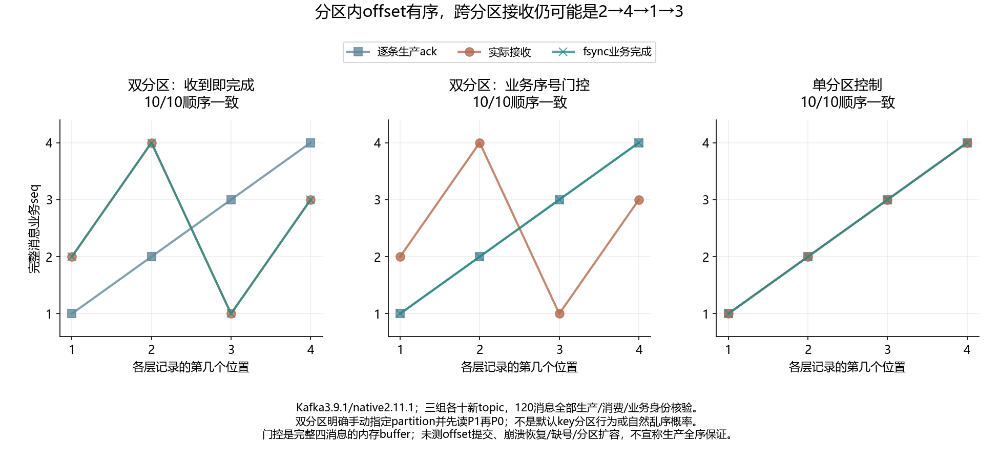

# 048 · 发送顺序是1到4，跨分区消费为什么变成另一种顺序？

分区内顺序能否推出跨分区全局业务顺序？

## 实验方法

固定真实生产顺序与两分区，受控读取调度；单分区或业务序列校验Good各十。

## 环境

Python 3.12；PowerShell 7。

Docker Engine 的 Linux 容器模式及 Docker Compose。

## 运行

在仓库根打开 PowerShell，按顺序执行：

~~~powershell
cd labs/048-kafka-cross-partition-order
./scripts/reproduce.ps1
./scripts/cleanup.ps1
~~~

每次运行生成新的 results 子目录，包含 stdout、stderr、环境信息和校验清单；这些本机输出默认由 Git 忽略。预期的错误退出由实验验证器判定，不能只凭子进程退出码判断修复是否成立。

## 示例结果

真实Kafka3.9.1/native2.11.1，三组各十新topic，120完整消息。生产逐条ack为1/2/3/4，双分区手动先P1后P0实际接收2/4/1/3；Bad收到即完成同序；Good相同接收用seq buffer完成1/2/3/4；单P控制三层均1/2/3/4。每个分区offset递增。

图与 CSV 来自一次固定环境中的历史运行，供理解对照关系；新运行的精确时间、PID、内存和调度数据可能不同。此目录的复现入口会执行新的实验，不依赖历史原始日志。

## 代码入口

- [实现与领域验证](src)
- [实验入口](scripts/reproduce.ps1)
- [容器配置](docker-compose.yml)

清理脚本只作用于本实验的进程、容器、集群或工作目录；请先阅读脚本。实验中的固定口令用于本地演示环境。
