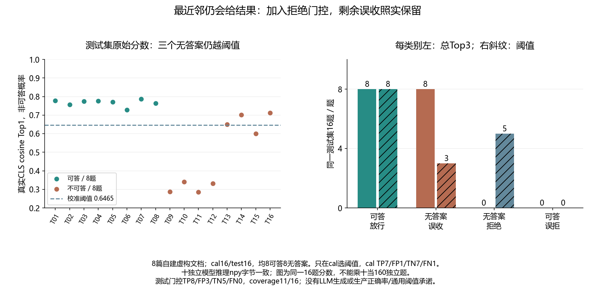

# 049 · 没有答案的问题，向量检索为什么仍给出三个结果？

最近邻结果是否等于问题在语料中可回答？

## 实验方法

固定真实BGE与人工answerable/unanswerable集；always-topK与校准拒答策略，十次推理，逐题回归。

## 环境

Python 3.12；PowerShell 7。

此入口按 Windows x64 / CPython 3.12 整理；部分依赖和进程检查使用 Windows 专用实现。

先执行 028 的 scripts/start.ps1，创建共用的本地模型、依赖环境及下载校验记录；049 推理使用本地缓存。

## 运行

在仓库根打开 PowerShell，按顺序执行：

~~~powershell
cd labs/049-rag-irrelevant-neighbors
./scripts/reproduce.ps1
~~~

每次运行生成新的 results 子目录，包含 stdout、stderr、环境信息和校验清单；这些本机输出默认由 Git 忽略。预期的错误退出由实验验证器判定，不能只凭子进程退出码判断修复是否成立。

## 示例结果

真实BGE-small-zh-v1.5/固定revision，8自建虚构文档；cal/test各16题、各8可答8不可答。总Top3测试误收8/8；只cal选阈值0.6465015411，测试误收3/8/误拒0/8/放行11/16。cal自身TP7/FP1/TN7/FN1，修复并不完美。十模型新进程真实推理npy字节一致。

图与 CSV 来自一次固定环境中的历史运行，供理解对照关系；新运行的精确时间、PID、内存和调度数据可能不同。此目录的复现入口会执行新的实验，不依赖历史原始日志。

## 代码入口

- [实现与领域验证](src)
- [实验入口](scripts/reproduce.ps1)
- [固定输入](data)

清理脚本只作用于本实验的进程、容器、集群或工作目录；请先阅读脚本。实验中的固定口令用于本地演示环境。
