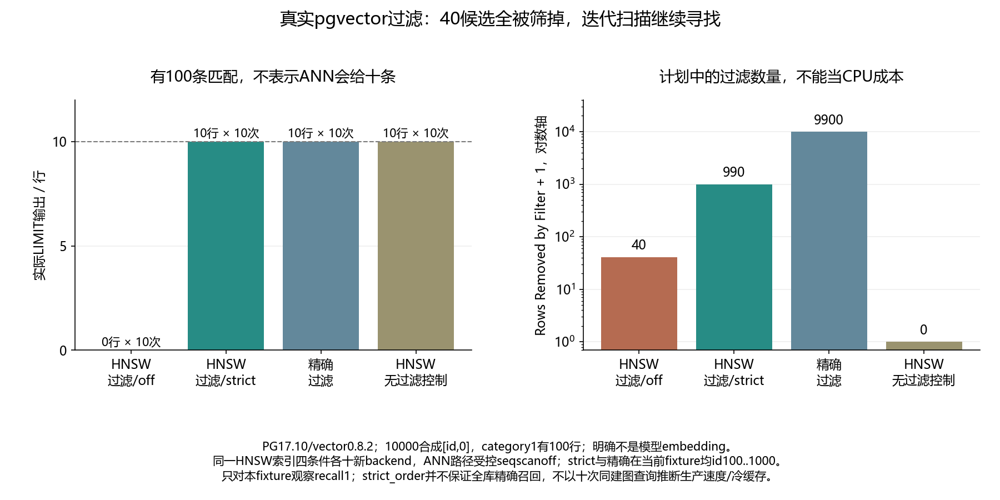

# 050 · 向量查询LIMIT10，为什么加过滤后只返回几行？

HNSW候选搜索与过滤、迭代扫描如何影响结果数量和准确性？

## 实验方法

固定数值向量fixture，精确/低ef ANN/iterative-scan对照各十；真PG计划与完整排名。

## 环境

Python 3.12；PowerShell 7。

Docker Engine 的 Linux 容器模式及 Docker Compose。

## 运行

在仓库根打开 PowerShell，按顺序执行：

~~~powershell
cd labs/050-pgvector-filtered-ann
./scripts/reproduce.ps1
./scripts/cleanup.ps1
~~~

每次运行生成新的 results 子目录，包含 stdout、stderr、环境信息和校验清单；这些本机输出默认由 Git 忽略。预期的错误退出由实验验证器判定，不能只凭子进程退出码判断修复是否成立。

## 示例结果

PG17.10/pgvector0.8.2真实查询，10000合成[id,0]、100条category1。HNSW ef40过滤/off十次返回0/筛40；strict迭代十次返回10/筛990，当前id100..1000与精确一致；精确十次返回10/筛9900；无过滤HNSW控制十次id1..10。40实际backend，同一已建索引。

图与 CSV 来自一次固定环境中的历史运行，供理解对照关系；新运行的精确时间、PID、内存和调度数据可能不同。此目录的复现入口会执行新的实验，不依赖历史原始日志。

## 代码入口

- [实现与领域验证](src)
- [实验入口](scripts/reproduce.ps1)
- [SQL](sql)
- [容器配置](docker-compose.yml)

清理脚本只作用于本实验的进程、容器、集群或工作目录；请先阅读脚本。实验中的固定口令用于本地演示环境。
